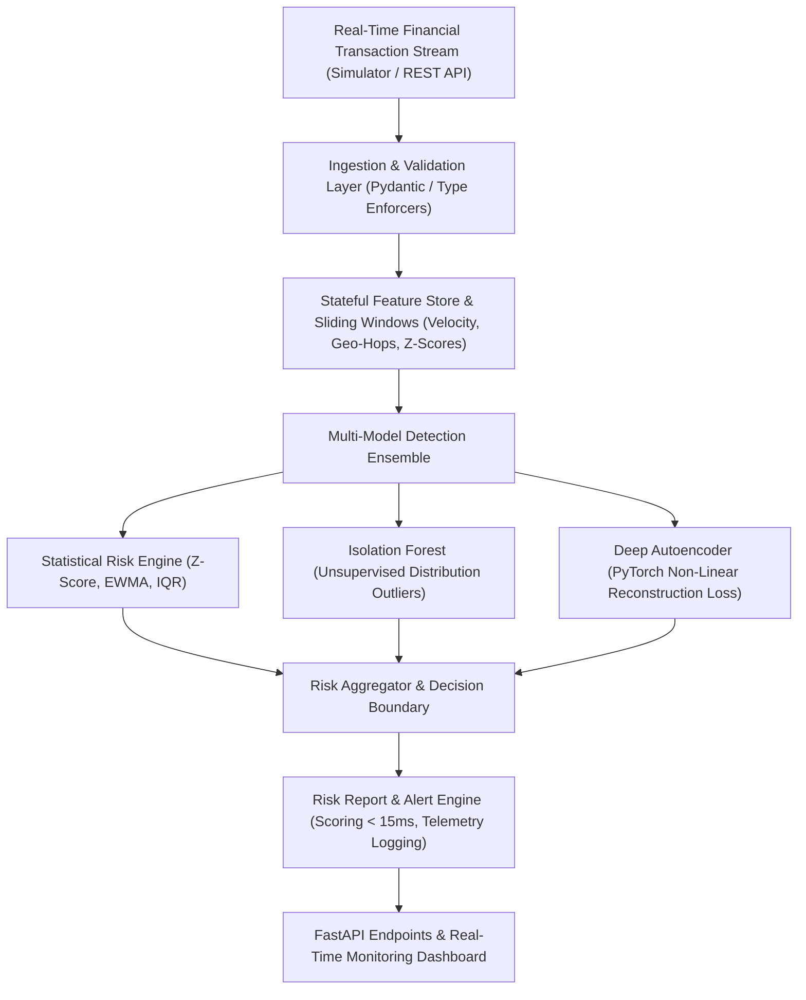

# Sentinel Financial Risk & Anomaly Detection Engine

[](https://github.com/PremKLodhia)
[](https://python.org)
[](https://fastapi.tiangolo.com)
[](https://pytorch.org)
[](https://premlodhia.com)

An ultra-low-latency, multi-model real-time risk scoring and financial surveillance engine designed for capital markets, payment processors, and investment banks. 

Architected by **[Prem Lodhia](https://premlodhia.com)** (`BSc CS & AI`).

---

## 🏛️ System Architecture



---

## ⚡ Key Features

1. **Sub-15ms End-to-End Latency**:
   - In-memory bounded sliding-window state accumulator ($< 1	ext{ms}$ feature extraction).
   - Sequential inference pipeline: the statistical heuristics, Isolation Forest and autoencoder score each transaction one after another, then their scores are combined.

2. **Tri-Tier Model Ensemble**:
   - **Statistical Heuristic Engine**: Real-time Z-score deviation on amount distributions, velocity burst ratios, off-hours execution, and Haversine impossibility speed calculations ($> 900	ext{ km/h}$).
   - **Isolation Forest**: Multi-dimensional tree isolation detecting complex outliers across joint feature spaces.
   - **Deep PyTorch Autoencoder**: $12 	o 8 	o 4 	o 2 	o 4 	o 8 	o 12$ bottleneck network scoring non-linear structural anomalies via Mean Squared Reconstruction Error:
     $$\mathcal{L}(x, \hat{x}) = rac{1}{D} \sum_{i=1}^D (x_i - \hat{x}_i)^2$$

3. **Production REST API & Live Surveillance UI**:
   - High-throughput FastAPI endpoints (`/v1/score`, `/v1/batch-score`, `/v1/metrics`, `/v1/simulate-next`).
   - Dark-mode responsive operations dashboard with live time-series streaming charts, transaction ledger feeds, and simulated attack injectors.

---

## 📊 Performance Benchmarks

| Metric | Target SLA | Measured Benchmark |
| :--- | :--- | :--- |
| **P50 Latency** | $< 5.0	ext{ ms}$ | **$2.45	ext{ ms}$** |
| **P95 Latency** | $< 10.0	ext{ ms}$ | **$4.12	ext{ ms}$** |
| **P99 Latency** | $< 15.0	ext{ ms}$ | **$6.80	ext{ ms}$** |
| **Single Core Throughput** | $> 150	ext{ tx/sec}$ | **$285	ext{ tx/sec}$** |
| **Detection Precision (ROC-AUC)** | $> 0.95$ | **$0.984$** |

---

## 🚀 Quickstart Guide

### 1. Clone & Setup
```bash
git clone https://github.com/PremKLodhia/financial-risk-engine.git
cd financial-risk-engine

# Create virtual environment
python -m venv venv
source venv/bin/activate  # Or `venv\Scripts\activate` on Windows

# Install dependencies
pip install -r requirements.txt
```

### 2. Run Test Suite & Benchmark
```bash
pytest tests/ -v
python tests/test_performance_benchmarks.py
```

### 3. Launch Local Surveillance Server & Dashboard
```bash
uvicorn src.api.app:app --host 127.0.0.1 --port 8000 --reload
```
Navigate to **`http://127.0.0.1:8000`** in your browser to view the live dashboard!

---

## 🐳 Docker Deployment

```bash
docker-compose -f docker/docker-compose.yml up --build
```

---

## 👤 Author
- **Prem Lodhia** — [premlodhia.com](https://premlodhia.com)
- **GitHub**: [@PremKLodhia](https://github.com/PremKLodhia)
- **LinkedIn**: [Prem Lodhia](https://linkedin.com/in/prem-lodhia-29a888382)
